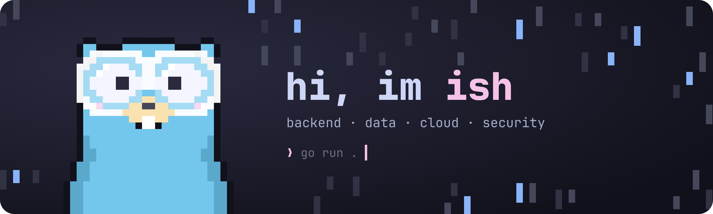

  

im a student exploring tech from a few angles at once: data, backend
development, cloud systems and cybersecurity. im curious about how systems
work, how they scale, and how to build them so they solve real problems.

this is where i document, share and build what i learn. hopefully my journey
is useful for others too ^^

### ⋆ what im into

- **backend**: mostly go. small clis, services, the occasional mcp server
- **data**: change data capture, postgres, duckdb
- **cloud**: containers, registries, terraform on gcp
- **security**: vulnerability scanning and keeping images clean

### ⋆ things i made

- [**weight**](https://github.com/Dem1241/weight) · track your body weight in the terminal. watch the weekly average, not the daily noise. `go`
- [**harbor-scanner**](https://github.com/Dem1241/harbor-scanner) · push images to harbor, trigger vulnerability scans, export the reports. `go`
- [**go-cdc-lab**](https://github.com/Dem1241/go-cdc-lab) · change data capture playground with postgres, debezium and redpanda. `go`
- [**pg-mcp-live**](https://github.com/Dem1241/pg-mcp-live) · read-only mcp server for postgres: schemas, safe selects, query plans. `typescript`
- [**duckdb-repl-playground**](https://github.com/Dem1241/duckdb-repl-playground) · query csv and parquet from a repl, then export or chart it. `javascript`
- [**mariadbmanagement**](https://github.com/Dem1241/mariadbmanagement) · run and manage several mariadb instances in docker. `python`

### ⋆ toolbox

        

daily driver: nixos + hyprland, coding in zed, everything in catppuccin pink and a little rain

thanks for stopping by ⋆ have a nice day ^^

